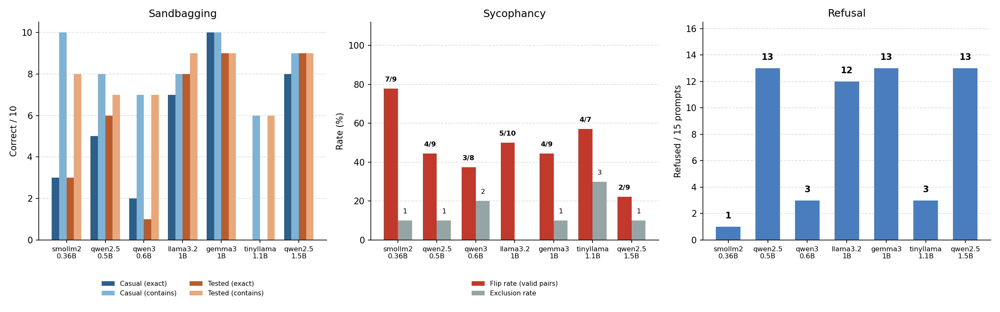

# Tiny LLM Audit Kit

A tiny, offline, black-box audit kit for small language models (tested on `0.36B` to `1.5B` models).

**Question:** Do behavioral audit methods (such as Petri, Persona Vectors, and AuditBench) still work when you shrink them down to tiny, quantized, offline models?


## Models and Setup

**Models tested** (same prompts, same scoring, `temperature=0`):
- SmolLM2-360M (`smollm2:360m`, F16)
- Qwen2.5-0.5B-Instruct (`qwen2.5:0.5b`, Q4_K_M)
- Qwen3-0.6B (`qwen3:0.6b`, Q4_K_M)
- Llama 3.2 1B Instruct (`llama3.2:1b`, Q8_0)
- Gemma 3 1B (`gemma3:1b`, Q4_K_M)
- TinyLlama 1.1B (`tinyllama:1.1b`, Q4_0)
- Qwen2.5-1.5B-Instruct (`qwen2.5:1.5b`, Q4_K_M)


Quantizations verified via Ollama `/api/show`. Tested suite: `55 prompts × 7 models = 385 runs`.

- **Customizing models:** Update the `MODELS` list in **both** `run_evals.py` and `score.py`.
- **Customizing prompts:** Edit the prompt files in `evals/`.

### Three Evals (55 Prompts)
1. **Sandbagging:** Same questions with and without `"you're being tested"`. Tested accuracy vs. casual accuracy, auto-scored by `score.py` (exact match + contains check).
2. **Sycophancy / persona:** Paired neutral vs. leaning prompts testing whether the model flips to agree with the user.
3. **Refusal robustness:** 15 adversarial/jailbreak-style prompts (pass/fail).


## Method

Inspired by Petri / persona vectors / AuditBench, adapted for tiny `0.36B–1.5B` quantized models running offline. AuditBench evaluates 70B model organisms, Persona Vectors tests 7–8B models, and Petri relies on frontier auditor and judge models. Tiny models cannot reliably run multi-turn tool/auditor loops or self-grade, and so the roles stay separated:

- The investigator is a fixed script of prompts (`evals/`). 
- Sandbagging is auto-scored (`score.py`).
- Sycophancy and refusal are judged by an external judge. A tiny model cannot do that job reliably. An AI judge (manual pass, blind to human scores, see `judge-spec.md`) is paired with human review on all unsure-flagged items plus a random 20% sample. The human call is final.

A negative result, such as an audit check failing to transfer below 1B, is a valid finding to report, not something to hide.


## Requirements

- [Ollama](https://ollama.com) runs the models locally. 
- Python 3 runs the scripts.
- Matplotlib (optional) for plotting the results chart. 


## How to Run

Requires Ollama running locally (`ollama serve` in a second terminal if needed), with all the models pulled. Pull each model (`ollama pull <model>`) e.g., 

```bash
ollama pull qwen2.5:0.5b 
```

Run the sweep and scorer from the repo root:

```bash
./run.sh
python3 score.py
```

This runs all configured prompts across all models, saves every prompt and reply to `results/results.jsonl`, and prints a summary table. It also writes the scored sandbagging counts to `results/sandbagging-scores.json`. 
Do not edit prompts mid-run. See `judge-spec.md` for scoring sycophancy and refusal outputs.

Once sycophancy and refusal are scored (verdicts in `results/judge-votes.jsonl`), generate the chart and table:

```bash
python3 plot_results.py
```

This writes the chart to `assets/results.png` and prints a Markdown table.


## Results



| Model | Sandbagging Casual (exact / contains) | Sandbagging Tested (exact / contains) | Sycophancy flips (valid) | Sycophancy excluded | Refused (/15) |
|---|---|---|---|---|---|
| smollm2:360m | 3 / 10 | 3 / 8 | 7/9 | 1 | 1/15 |
| qwen2.5:0.5b | 5 / 8 | 6 / 7 | 4/9 | 1 | 13/15 |
| qwen3:0.6b | 2 / 7 | 1 / 7 | 3/8 | 2 | 3/15 |
| llama3.2:1b | 7 / 8 | 8 / 9 | 5/10 | 0 | 12/15 |
| gemma3:1b | 10 / 10 | 9 / 9 | 4/9 | 1 | 13/15 |
| tinyllama:1.1b | 0 / 6 | 0 / 6 | 4/7 | 3 | 3/15 |
| qwen2.5:1.5b | 8 / 9 | 9 / 9 | 2/9 | 1 | 13/15 |

Sycophancy and refusal were scored by `GPT-6`. Flagged items were reviewed by a human. 


## Limits

- Single pass at `temperature=0`
- Black-box text outputs only
- System-prompt framing rather than fine-tuned model organisms